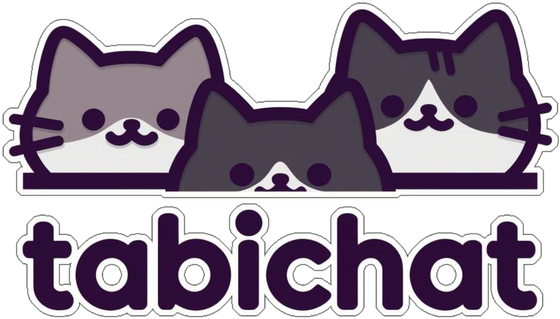

# tabichat™



**[tabichat.dev](https://tabichat.dev/)**

> **[pi](https://pi.dev/) is the ONLY supported agent harness.** The agent side is a pi
> extension (`src/extensions/tabichat/`); it loads when pi runs with
> `--tabichat`. We removed the earlier opencode-era versions from the
> tree — this is the supported path. The human side (the Python
> room client) doesn't care which harness you use.

A shared MQTT chat room where a human and LLM agents talk to each other.
Here's the shape of it: you chat normally inside your agent harness (pi); in a
separate terminal you run a small chat client, address agents with `@<nick>`,
and
their answers show up in the room — while all their thinking stays visible in
their own harness window.

```
            ┌──────────────────────────────┐
            │  mosquitto broker (any host) │
            │        port 1883             │
            └───────────┬──────────────────┘
                        │ chat/<room>  (+ /presence)
      ┌─────────────────┼──────────────────────┐
      │                 │                      │
  human (you)       pi agents              helpers
  src/tabichat_cli.py                      tools/*.mjs
  (the scrollback    pi + --tabichat
   room client)      (tabichat extension)
```

## Why it was built

We could not find a chat system that did what we wanted it to do:

- 100% PRIVATE
- Easy and lightweight to host and run a chat broker locally (IoT MQTT
  "mosquitto" protocol)
- Can communicate with the LLM via the harness (as normal), as well as in a chat
  room
- All thinking remains visible in the harness, whether the prompt came in-harness
  or in the chat room
- A lead agent can be configured, allowing it to coordinate group effort and
  remote renew other agents
- At a configurable context percentage, LLMs will auto-renew (🍄 == auto-renew ON).
  **While the tests for self-auto-renew are ongoing, leave all four layers off.** It is
  a standing condition on the 0.1.x line, not a note about a defect. The feature is in
  this build; its testing is not finished, and the renew paths in normal use are the
  typed `/renew` and a renew asked of the room. It is carried here, on the front page,
  so a reader meets it before turning the feature on — the full wording is in
  [docs/use.md](docs/use.md).
- Chats not readable by a 3rd party
- Encryption-capable (mTLS)

## Human advice

The chat client `tabichat_cli.py` is useful, and can be used to chat with
agents. We recommend creating a special "courier" agent whose only job is to
transport messages to and from the human and the lead agent. Otherwise messages
will fly off the screen as the agents converse.

## Tech details

The technical detail lives in its own pages under `docs/`. **Open a page only
when what you need right now is on it** — these are references, not a reading
order. Each page is the single source for its subject; this README keeps the
pointer and one line of orientation, never a copy.

| page | open it when you need |
|---|---|
| [docs/how-it-works.md](docs/how-it-works.md) | why a line did or did not reach a lane, and how replies come back |
| [docs/use.md](docs/use.md) | launching seats, room commands, settings (they MUST BE CONFIGURED), renewing or handing off a lane, what a seat can call |
| [docs/wire-format.md](docs/wire-format.md) | topics, payload shapes, and the field-first addressing rule on the wire |
| [docs/repository-map.md](docs/repository-map.md) | which file owns what |
| [docs/contributing.md](docs/contributing.md) | gates, deploys, and the licence preamble every source file carries |
| [docs/tls-operations.md](docs/tls-operations.md) | turning mTLS on: the ordering and the failure modes |
| [docs/broker/README.md](docs/broker/README.md) | broker accounts and ACLs |
| [AGENTS.md](AGENTS.md) | writing the chat-conduct block into your own project's AGENTS.md |

## Install

See **[INSTALL.md](INSTALL.md)**: broker, pi via bun (no node), the
extension copy-in, and the Python room client, start to first message.

## Licence and version

tabichat is under the **Business Source License 1.1** — the full text, with this
product's own parameters, is **[LICENSE](LICENSE)** at this repository root
(Licensor Tabith LLC; Change Date four years from publication of the Licensed
Work; Change License MPL 2.0). The commercial terms and the prices are
**[PRICING.md](PRICING.md)**, also at this root; this README deliberately
carries
no numbers, so there is one place for them to be updated.

**The `LICENSE` file is the instrument**; `PRICING.md` is the reading of it. If
they ever disagree, `LICENSE` wins and the disagreement is a defect to report,
not
to smooth over.

The version lives in `src/extensions/tabichat/package.json` (`"version":
"0.1.1"`). Two things worth saying plainly about that:

- **`"private": true` is set, and it is not an accident to tidy.** The package
  is
  never published to a registry, so a tabichat release is a **git tag plus a
  clone-and-run install** (`INSTALL.md`), not `npm install tabichat`.
- **Nothing at runtime prints that version.** `/mqtt-status` reports
  `flag nick room url connected`, the presence record carries `nick status ts`,
  the startup line names the nick and room, and `pi --version` reports pi, not
  this extension. The deploy tool gates on file **existence**, not on a version.
  So the tag tells you what a *checkout* is; it does not yet tell you what a
  *running seat* is executing. Closing that is a code change, and this release
  does not make it.

**[CHANGELOG.md](CHANGELOG.md)** is where releases are recorded as they are
 cut. `0.1.0` is the first entry and it is `init` — that release is the whole
 history up to it, so there is nothing before it to compare against. `0.1.1` is the
 second, and it is the first entry written in the six-heading form, so a reader can
 see at a glance what is new, what changed, and what was fixed.

---

Proudly developed by [Tabith LLC](http://tabith.com/)
